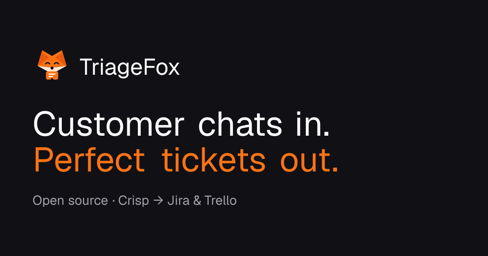

<p align="center">
  
</p>

<p align="center">
  <a href="https://triagefox.com"><b>Website</b></a> ·
  <a href="docs/self-hosting.md"><b>Self-host</b></a> ·
  <a href="docs/README.md"><b>Docs</b></a> ·
  <a href="https://github.com/kartik01a/TriageFox/discussions"><b>Discussions</b></a>
</p>

<p align="center">
  <a href="LICENSE"></a>
  <a href="https://github.com/kartik01a/TriageFox/actions/workflows/ci.yml"></a>
  <a href="https://github.com/kartik01a/TriageFox/tags"></a>
</p>

# TriageFox

TriageFox reads your [Crisp](https://crisp.chat) support chats and turns the ones that need a code change into clean tickets in **Jira** and **Trello**: bugs, UI problems, feature requests and performance issues. Questions like "how do I reset my password?" don't become tickets.

<!-- Demo: add the recording as docs/assets/demo.gif, then replace this line with:   -->

## What it does

- **Writes the ticket for you.** A clear title, a summary, steps to reproduce, expected vs actual, and the screenshots and files the customer sent. Voice notes are transcribed.
- **Sets a priority from 1 to 5** with a fixed rubric (outage or data loss is 5, a cosmetic glitch is 1), mapped to Jira priorities and Trello label colours.
- **Never invents due dates.** A date is added only when the customer actually named one ("by Friday").
- **Follows the conversation.** When the customer adds details later, the same ticket gets a comment instead of a new ticket. Edits your team made by hand are never overwritten.
- **Merges duplicates.** When a second customer reports the same bug, the first ticket shows "Reported by 2 customers" instead of a copy.
- **Keeps you in control.** An activity log explains every decision, unsure tickets wait in a review queue, and you can try it on your last 10 conversations before switching it on.

## How it works

```
Crisp chat ──hook──▶ TriageFox ──(quiet ~3 min)──▶ AI triage ──▶ Jira issue / Trello card
                        │                              │
                        └─ re-reads the conversation   └─ create · update · duplicate · no ticket
```

1. Crisp sends a signal when a message arrives or a chat is resolved. TriageFox stores only the ids and waits until the customer stops typing.
2. It re-reads the conversation from Crisp, and an AI model (OpenAI) decides whether it describes a code change. The model has no tools, and its answer must pass a strict schema.
3. The ticket is created in every destination you connected, or the existing ticket gets an update.

Design details: [architecture](docs/architecture.md) · [AI triage rules](docs/ai-triage.md) · [Crisp](docs/integrations/crisp.md), [Jira](docs/integrations/jira.md), [Trello](docs/integrations/trello.md).

## Privacy and security

- **No chat transcripts are stored.** Webhook events are kept as identifiers only, and AI working notes are encrypted.
- **Credentials are sealed.** Jira and Trello tokens are encrypted with a key pair whose private half only the background worker has. The web app can save them but never read them back.
- **Workspaces are isolated** in the data-access layer and again with Postgres row-level security.
- **Read-only on Crisp.** TriageFox never sends messages or changes conversations.

More in [docs/security.md](docs/security.md). Found a vulnerability? Please follow [SECURITY.md](SECURITY.md) instead of opening an issue.

## Two ways to use it

| | Hosted | Self-hosted |
|---|---|---|
| Where | [triagefox.com](https://triagefox.com) | Your own server (Docker Compose) |
| Setup | Install the Crisp plugin, connect Jira or Trello | Register your own Crisp, Trello and Atlassian apps |
| AI | Included, or bring your own OpenAI key | Your own OpenAI key |
| Price | Free trial, then a subscription | Free (AGPL-3.0) |

### Self-host

```bash
git clone https://github.com/kartik01a/TriageFox.git && cd TriageFox
./deploy/setup.sh                                   # asks for your domain, generates every secret
# fill in your Crisp / Trello / Jira / OpenAI / email settings in deploy/.env
docker compose -f deploy/docker-compose.yml up -d
```

Ready-made images for Intel and ARM servers are published as `ghcr.io/kartik01a/triagefox-web` and `ghcr.io/kartik01a/triagefox-worker`. Step by step, including registering the Crisp, Trello and Atlassian apps, backups and a hardening checklist: **[docs/self-hosting.md](docs/self-hosting.md)**.

## Develop locally

Requirements: Node 22, pnpm 10, Docker.

```bash
pnpm install
pnpm keys:generate      # creates .env with local secrets (never printed)
pnpm infra:up           # Postgres (pgvector), Redis, Mailpit
pnpm db:migrate && pnpm db:seed
pnpm dev                # web on http://localhost:3000, worker alongside
```

Emails sent locally (verification, invitations) appear in Mailpit at http://localhost:8025.

```bash
pnpm lint && pnpm typecheck && pnpm test      # unit and database tests
pnpm --filter @triagefox/web e2e              # browser tests (needs `pnpm dev` or it starts one)
```

Built with TypeScript, Next.js, a BullMQ worker, Postgres with pgvector, Drizzle and Better Auth. Layout and conventions: [docs/development.md](docs/development.md).

## Contributing

Contributions are welcome. Small fixes can go straight to a pull request. For anything bigger, such as a new connector (Linear, GitHub Issues, Intercom…), open an issue or a [discussion](https://github.com/kartik01a/TriageFox/discussions) first so we agree on the approach. Read [CONTRIBUTING.md](CONTRIBUTING.md) before your first pull request, and see [adding a connector](docs/integrations/adding-a-connector.md) and the [roadmap](docs/roadmap.md) for ideas.

## Built by

TriageFox is designed and built by **Kartik Singh Bisht**, a full-stack developer from India.

- Portfolio: [kartik-portfolio](https://kartik-portfolio-30081541625.asia-south1.run.app/)
- Hire me on [Upwork](https://www.upwork.com/freelancers/~01e74ab725bfcfa302)
- [LinkedIn](https://www.linkedin.com/in/kartik-singh-bisht-13816a207/) · [GitHub](https://github.com/kartik01a)

## License

[AGPL-3.0](LICENSE). You can use, change and self-host TriageFox freely. If you run a changed version as a service for others, you must share your changes under the same license.
